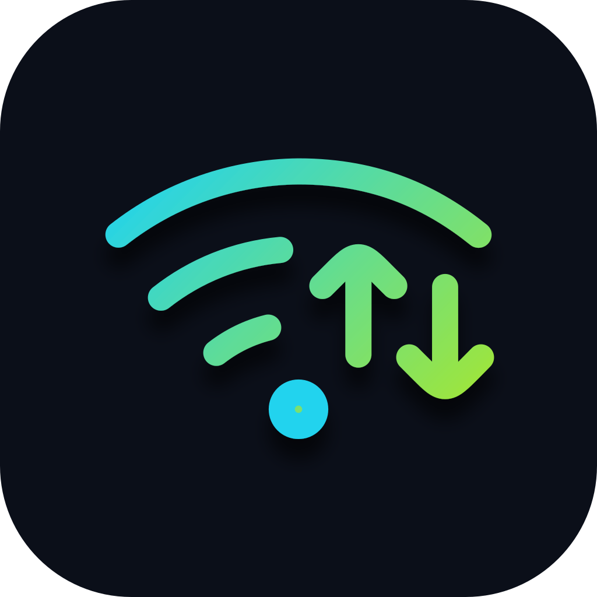

<p align="center">
  
</p>

<h1 align="center">WhatsMySpeed</h1>

<p align="center">
  <a href="https://github.com/sponsors/theshubh77"></a>
  <a href="LICENSE"></a>
</p>

A lightweight, native Windows 11 real-time internet speed monitor written in pure Go and Win32 APIs. **WhatsMySpeed** docks directly onto the Windows 11 taskbar to the left of the system tray overflow chevron (`^`), blending seamlessly with native Light and Dark taskbar themes.

## Features

- **Real-Time Speed Monitoring:** Polls active, non-loopback network interfaces every second using the Windows IP Helper API (`GetIfTable2`), filtering out NDIS/WFP filter shims to avoid double-counting traffic.
- **Jitter-Free Smart Formatting:** Automatically scales across **`Bytes/s`** (`B/s`, `KB/s`, `MB/s`, `GB/s`) or **`Bits/s`** (`bps`, `Kbps`, `Mbps`, `Gbps` — matching ISP plans, speed tests, and Task Manager) using fixed-width columns so numbers never jump horizontally as throughput changes.
- **Customizable Label Styles & Layouts:**
  - **Label Styles:** `Arrows (↑ ↓)` (Phosphor icons), `U / D`, or `Up / Down`
  - **Taskbar Layouts:** `Stacked (↑/↓)`, `Stacked (↓/↑)`, `Inline` (side-by-side), or `Compact`
  - **Display Modes:** `Show Both`, `Download Only`, `Upload Only`, `Hide Speed`
- **Built-In Speed Test & Dashboard (`Open WhatsMySpeed`):**
  - Launch the app icon (`WhatsMySpeed.exe` or shortcut) — whether for the first time or while running — click/double-click the system tray icon, double-click the taskbar speed overlay, or choose **Open WhatsMySpeed** from the tray right-click menu to open the dashboard.
  - Supports **Light**, **Dark**, and **System** theme icons (with hover tooltips), a live header download/upload badge, and a 270° animated speedometer gauge with multi-stream **Ping** (8 probes), **Download** (8s), and **Upload** (8s) phases separated by clean 1.5s intervals — resetting the gauge upon completion while preserving Ping, Download, and Upload summary pills (`Run Speed Test` / `Cancel` / `Test Again`).
  - Interactive capsule controls for every preference (`Show`, `Label`, `Layout`, `Unit`, `Theme`, `Start with Windows`), plus **GitHub** (`https://github.com/theshubh77/WhatsMySpeed`), **Sponsor**, and **Shubham Bhamare** ([LinkedIn](https://www.linkedin.com/in/theshubh77)) links.
- **Native Windows 11 Integration:**
  - Docks cleanly inside `Shell_TrayWnd` beside `TrayNotifyWnd` as a zero-focus-stealing transparent layered window (with automatic topmost fallback when needed), keeping proper taskbar Z-order even over Quick Settings, Start, and Alt+Tab.
  - Automatically reacts to taskbar resize, DPI scaling (`PerMonitorV2`), display changes, Explorer restarts, taskbar auto-hide, and fullscreen apps.
  - Single-instance mutex prevents duplicate background processes; launching the app icon opens and focuses the dashboard window on first launch and subsequent launches, while Windows auto-start (`--tray`) launches quietly to the taskbar and tray.
  - Automatically detects Windows 11 Light/Dark taskbar theme (`SystemUsesLightTheme` / `AppsUseLightTheme`) and renders anti-aliased `Segoe UI Variable Text` (falling back to `Segoe UI`).
- **App & Taskbar Icons Embedded:** Embeds the custom WhatsMySpeed application icon (EXE icon, window icon, and tray icon) and official [Phosphor Icons](https://phosphoricons.com/) directly into the standalone `.exe` with crisp multi-DPI rendering.
- **Full Persistence:** Automatically initializes and persists every control in `%APPDATA%\WhatsMySpeed\config.json`, keeping Windows startup (`Start with Windows` / `HKCU\Software\Microsoft\Windows\CurrentVersion\Run`) in sync.

## Project Structure

```text
WhatsMySpeed/
├── assets/
│   ├── app/                    # Application icon (.ico, .png, .svg)
│   ├── assets.go               # Embedded app logo & Phosphor SVGs (//go:embed)
│   └── icons/                  # Official Phosphor SVG icons
├── cmd/
│   └── whatsmyspeed/
│       ├── app.manifest        # Per-Monitor V2 DPI & Common Controls manifest
│       ├── app.rc              # Windows executable icon & version resource script
│       ├── main.go             # Application entry point & single-instance guard
│       └── rsrc_windows_amd64.syso # Pre-compiled Windows resources linked by go build
├── internal/
│   ├── config/
│   │   ├── autostart.go        # Windows startup registry management
│   │   └── config.go           # JSON settings persistence (%APPDATA%\WhatsMySpeed\config.json)
│   ├── network/
│   │   ├── format.go           # Smart unit formatting (B/s–GB/s and bps–Gbps)
│   │   └── monitor.go          # Win32 GetIfTable2 bandwidth sampler
│   ├── speedtest/
│   │   └── speedtest.go        # Multi-stream Ping, Download & Upload speed test
│   └── ui/
│       ├── gdiplus.go          # Pure-Go GDI+ flat API bindings
│       ├── icons.go            # SVG path parser & GDI+ vector rasterizer
│       ├── overlay.go          # Layered taskbar overlay & render loop
│       ├── settings_window.go  # Native Windows 11 settings & speedtest dashboard
│       ├── taskbar.go          # Shell_TrayWnd / TrayNotifyWnd positioning & fullscreen detection
│       ├── theme.go            # Windows 11 Light/Dark taskbar theme detection
│       ├── tray.go             # Shell_NotifyIconW system tray & context menu
│       └── win32.go            # Win32 syscalls & DPI awareness
├── build.ps1                   # Standalone Windows GUI build script
├── go.mod
├── LICENSE
└── README.md
```

## Prerequisites

- **OS:** Windows 11 (x64)
- **Go:** Go 1.22+ (pure Go, no CGO / GCC required)

## Build & Run

### Using the build script (PowerShell)

```powershell
.\build.ps1
.\WhatsMySpeed.exe
```

### Using `go build` directly

```powershell
go build -trimpath -ldflags="-s -w -H=windowsgui" -o WhatsMySpeed.exe ./cmd/whatsmyspeed
.\WhatsMySpeed.exe
```

> `-H=windowsgui` builds a native GUI subsystem executable so no console window appears on launch. `build.ps1` also automatically recompiles `rsrc_windows_amd64.syso` from `app.rc` if `x86_64-w64-mingw32-windres` is available on `PATH`.

### Running Tests

```powershell
go test -v ./...
```

## Configuration

Every control setting is automatically initialized and saved to:

```text
%APPDATA%\WhatsMySpeed\config.json
```

Example:

```json
{
  "display_mode": "both",
  "speed_unit": "bytes",
  "label_style": "arrows",
  "layout": "stacked_up",
  "theme": "system",
  "start_with_windows": true
}
```

- `display_mode`: `"both"`, `"download"`, `"upload"`, `"hide"`
- `speed_unit`: `"bytes"` (`B/s`–`GB/s`, default) or `"bits"` (`bps`–`Gbps`)
- `label_style`: `"arrows"` (Phosphor icons, default), `"ud"` (`U` / `D`), or `"words"` (`Up` / `Down`)
- `layout`: `"stacked_up"` (default), `"stacked_down"`, `"inline"`, or `"compact"`
- `theme`: `"system"` (default), `"dark"`, or `"light"`
- `start_with_windows`: `true` (default) or `false` (automatically kept in sync with `HKCU\Software\Microsoft\Windows\CurrentVersion\Run` using `--tray`)

## Contributing

Contributions, bug reports, and pull requests are welcome! Please run `go test ./...` before submitting changes.

## Author

- **Shubham Bhamare** — [LinkedIn](https://www.linkedin.com/in/theshubh77) · [GitHub](https://github.com/theshubh77)

## Sponsor

If you find **WhatsMySpeed** useful and would like to support its development, you can sponsor [@theshubh77 on GitHub Sponsors](https://github.com/sponsors/theshubh77).

## License & Credits

- Licensed under the [MIT License](LICENSE).
- App icon based on `andrsrxn:wifi-in-out` by [Andrés Raxón](https://github.com/andrsrxn/icons) (MIT License).
- Directional & UI icons from [Phosphor Icons](https://phosphoricons.com/) (MIT License).
